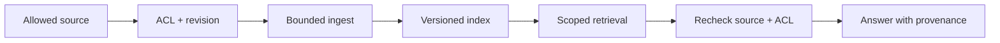

# synology-brain

Architektur des Firmen-Brains mit eigenem Git-Server (Forgejo) auf der Synology des Kunden.

**Interaktive Ansicht:** https://servas-ai.github.io/synology-brain/ · [Mindmap](https://servas-ai.github.io/synology-brain/mindmap.html) · [Produktbeschreibung](https://servas-ai.github.io/synology-brain/produkt.html)

## Architektur

## Mindmap

## Kurz erklärt

- Das gemeinsame Wissen liegt auf dem Git-Server auf der Synology.
- Jeder Mitarbeiter hat dort ein eigenes Konto und auf seinem Rechner eine eigene Kopie, mit nur den Bereichen, die sein Konto sehen darf.
- Der KI-Assistent (opencode) arbeitet in dieser Kopie und reicht neues Wissen zurück; der Mitarbeiter bestätigt selbst.
- KI-Modell (EU-Anbieter), Dokumente (SharePoint) und Vektorsuche (Qdrant) nutzt jeder direkt mit dem eigenen Login.

---

## 🧭 SERVAS Stack Map

> **servas-ai/synology-brain** · Architecture and product description. Architecture/ownership guide, not production-acceptance claim.

### ✨ Scope

- **Role:** Architecture and product description.
- **Boundary:** this repository owns only its documented component; other services remain their own source of truth.
- **Security:** least privilege, explicit principal/tenant scope, no secrets in Git/prompts, and read-only reconciliation for uncertain effects.
- **Release:** pin source SHA and distinguish unit/synthetic tests from live acceptance.

### 🗺️ System diagram

### 🖼️ Existing screenshots and visual assets

*Original repository visuals preserved. Their presence does not imply current runtime acceptance.*

### ✅ Readiness checklist

- [ ] Source and deployed revision recorded.
- [ ] Permissions and tenant/company scope verified.
- [ ] Failure, retry, revoke and restore tested.
- [ ] Runtime evidence linked; unit tests alone are not product acceptance.
- [ ] UI screenshots, if relevant, captured from the actual tested build.

### 🔗 Integration references

- [Unified SERVAS stack](https://github.com/Martin-Hausleitner/hans/blob/3cfe8247af2df90f8c7173251d7cf2cf9a7a29ff/sources/transcripts/meetings/2026-10-24-kira-servas-review/SERVAS-GESAMTSTACK-MATRIX-MACRO-PAPERCLIP-HANS.md)
- [WorkOS execution plan R3.1](https://github.com/Martin-Hausleitner/hans/blob/3cf6690f0c7c0f829f81a2c4f54e3463444a2a34/sources/transcripts/meetings/2026-10-24-kira-servas-review/repo-review-r2/EXECUTION-PLAN-R3.md)

*Visual README overlay for review. This section does not imply the component is live, merged or accepted.*
