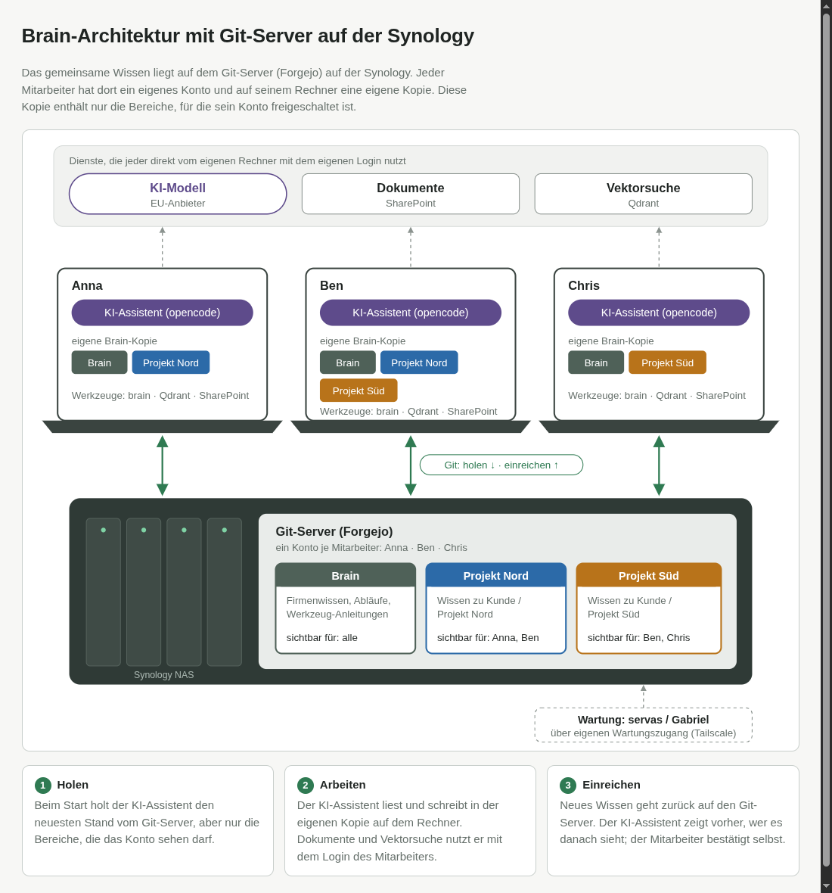
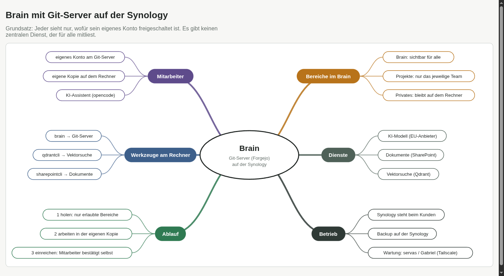

# synology-brain

Architektur des Firmen-Brains mit eigenem Git-Server (Forgejo) auf der Synology des Kunden.

**Interaktive Ansicht:** https://servas-ai.github.io/synology-brain/ · [Mindmap](https://servas-ai.github.io/synology-brain/mindmap.html) · [Produktbeschreibung](https://servas-ai.github.io/synology-brain/produkt.html)

## Architektur

## Mindmap

## Kurz erklärt

- Das gemeinsame Wissen liegt auf dem Git-Server auf der Synology.
- Jeder Mitarbeiter hat dort ein eigenes Konto und auf seinem Rechner eine eigene Kopie, mit nur den Bereichen, die sein Konto sehen darf.
- Der KI-Assistent (opencode) arbeitet in dieser Kopie und reicht neues Wissen zurück; der Mitarbeiter bestätigt selbst.
- KI-Modell (EU-Anbieter), Dokumente (SharePoint) und Vektorsuche (Qdrant) nutzt jeder direkt mit dem eigenen Login.
